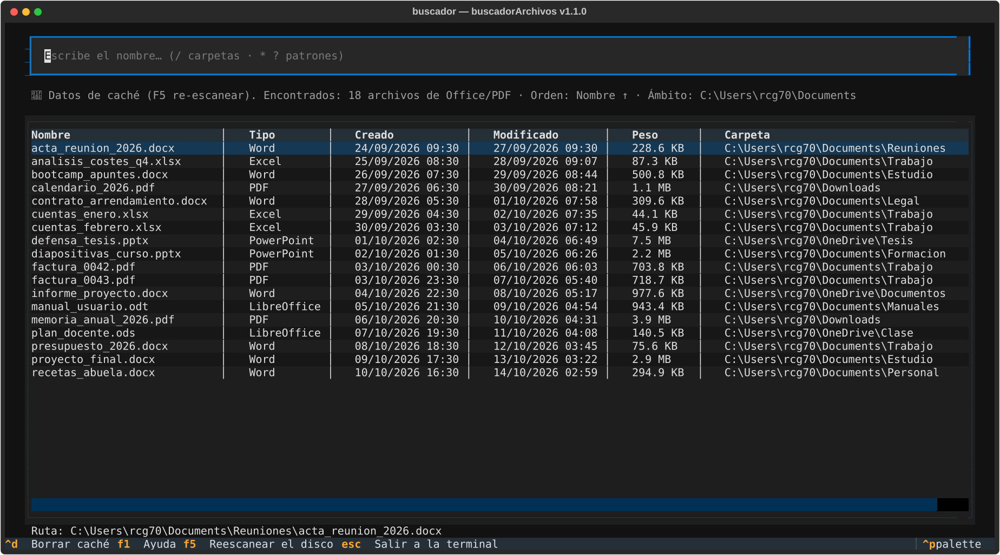

# buscadorArchivos

Buscador de archivos de Office y PDF **por nombre**, con resultados **mientras escribes**. Interfaz de terminal (TUI) ligera hecha en Python + [Textual](https://textual.textualize.io). Funciona en **Windows** y **Ubuntu**.



## Características

- 🔍 Búsqueda por nombre completo o parcial, filtrando al instante mientras tecleas.
- 📄 Busca Word (`.doc/.docx/.docm`), Excel (`.xls/.xlsx/.xlsm`), PowerPoint (`.ppt/.pptx/.pptm`), PDF y **LibreOffice** (`.odt/.ods/.odp`).
- 📊 Cada resultado muestra: **nombre, tipo, fecha de creación, fecha de modificación y peso**.
- 🎯 Lista ordenada por nombre (A→Z), navegable con **flechas y ratón**; `Enter` o doble clic abre el archivo con su aplicación predeterminada.
- 💾 **Caché del escaneo**: el disco completo se escanea una vez y las siguientes ejecuciones arrancan al instante (`F5` para re-escanear).

## Requisitos

- Python 3.10 o superior.

## Instalación y uso

### Windows (CMD o PowerShell)

```cmd
:: 1. Ve a la carpeta del proyecto
cd buscadorArchivos

:: 2. Instala (dependencias + comando global "buscador")
instalar.cmd

:: 3. Úsalo desde cualquier terminal
buscador
buscador "C:\Users\rcg70\Documents"
```

### Linux Ubuntu (terminal)

```bash
# 1. Ve a la carpeta del proyecto
cd buscadorArchivos

# 2. Instala (dependencias + comando global "buscador")
bash instalar.sh

# 3. Úsalo desde cualquier terminal
buscador
buscador /media/datos ~/Documentos
```

Si `buscador` no se encuentra después de instalar, agrega `~/.local/bin` a tu PATH:
```bash
echo 'export PATH="$HOME/.local/bin:$PATH"' >> ~/.bashrc && source ~/.bashrc
```

### Alternativa manual (sin el instalador, en ambos sistemas)

```bash
python -m pip install -r requirements.txt
python -m buscador            # todo el disco
python -m buscador "C:\ruta"  # carpetas concretas
```

Otra opción estándar (requiere que tu Python tenga `Scripts` en PATH):
```bash
python -m pip install -e .
buscador
```

## Cómo funciona

- Sin argumentos busca en todo el disco (todos los rígidos en Windows, `/` en Linux); con rutas, solo en esas carpetas.
- El primer escaneo de todo el disco puede tardar unos minutos; el resultado se guarda en caché en tu perfil de usuario:
  - Windows: `%LOCALAPPDATA%\buscador-archivo\cache.json`
  - Ubuntu: `~/.cache/buscador-archivo/cache.json`
- Los cambios del disco (archivos creados o borrados después del último escaneo) se reflejan con `F5`.

## Atajos

| Tecla | Acción |
|-------|--------|
| (escribir) | Filtrar resultados al instante |
| ↑ / ↓ | Moverse entre resultados |
| Enter / doble clic | Abrir archivo seleccionado |
| F5 | Re-escanear el disco y actualizar la caché |
| Ctrl+Q | Salir |

## Estructura del código

```
buscador/
├── escaner.py   # recorre el disco, filtra extensiones, guarda y carga la caché
├── app.py       # interfaz TUI (Textual): búsqueda en vivo + tabla de resultados
└── __main__.py  # punto de entrada (python -m buscador)
```

## Licencia

MIT
